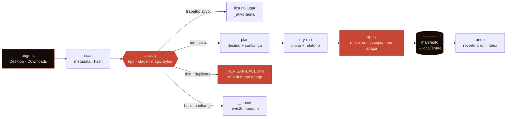

<!-- Banner -->
<div align="center">
  
</div>

<!-- Typing -->
<div align="center">
  <a href="https://sixquasar.shop">
    
  </a>
</div>

<!-- Status -->
<div align="center">
  
  
  
  
  
  
</div>

<br>

> O **macos-organizador** arruma Desktop e Downloads sem quebrar o que você estava fazendo. Ele **move, nunca apaga**: o que parece lixo vai pra quarentena e a exclusão é sempre sua. Antes de inventar pasta, procura a **casa que já existe** na sua máquina. O que é trabalho ativo **fica onde está**. E toda execução escreve um **manifesto**, então dá pra desfazer tudo com um comando.

<br>

## O que é


```yaml
produto:      macos-organizador — plugin Claude Code
escopo:       Desktop · Downloads · pastas soltas
invariante:   move, nunca apaga — a exclusão é sempre do humano
destino:      a casa canônica que já existe vence a pasta nova
reversão:     manifesto por run · undo completo
quarentena:   _REVISAR-EXCLUIR/ — lixo e duplicatas esperam sua conferência
incerteza:    baixa confiança não decide — vai pra _inbox/
runtime:      Python 3 (stdlib) · zero dependência
```

<br clear="right"/>

O coração é a **assimetria entre mover e apagar**. Mover é reversível: um manifesto por run
guarda cada `origem → destino`, e o `undo` desfaz. Apagar não é. Por isso o engine nunca apaga
— nem o `.dmg` de um app que já está instalado, nem a pasta vazia, nem a duplicata exata. Ele
separa, explica por quê, e deixa a decisão irreversível com você.

<br>

## Capacidades

| Capacidade | Etapa | Garantia |
|---|:---:|:---:|
| 🔎 **scan** de origens com metadata, tamanho e hash de conteúdo | `scan` | read-only |
| 🧭 **casa canônica primeiro** — procura o destino que já existe antes de criar pasta nova | `plan` | determinística |
| 🔥 **trabalho ativo preservado** — cluster recente por `mtime` + correlação fica acessível | `plan` | não arquiva o que está em uso |
| 🧬 **duplicata exata** por hash de arquivo e assinatura de pasta | `plan` | byte a byte |
| 🎭 **extensão honesta vence** — `.pdf` que na verdade é markdown perde pro irmão bem nomeado | `plan` | magic bytes |
| 🗑️ **quarentena, não exclusão** — vazios, instaladores e cópias vão pra `_REVISAR-EXCLUIR/` | `plan` | só o humano apaga |
| ❓ **baixa confiança não decide** — vai pra `_inbox/` em vez de chutar destino | `plan` | sem palpite |
| 🧾 **manifesto reversível** — cada run registra `origem → destino` | `apply` | `undo` completo |
| 🔦 **rastreio** — descobre onde um arquivo foi parar | `where` | índice de atividade |

> [!NOTE]
> **Dry-run é o padrão.** `/organizar` sem argumento apenas **planeja**: escreve o plano, o
> relatório e não toca em nada. Só `--apply` move, e mesmo assim tudo volta com `--undo`.

<br>

## Arquitetura

As origens são varridas, cada item é classificado por tipo, idade e sinais de conteúdo, e o
plano decide entre quatro saídas: fica no lugar, vai pra casa canônica, vai pra quarentena ou
vai pra revisão humana. Nada é movido antes do `apply`, e o `apply` só escreve depois de
registrar a intenção no manifesto.



<br>

## Princípios

1. **Nunca apaga.** Lixo e duplicatas vão pra `_REVISAR-EXCLUIR/`. A operação irreversível é sempre do humano.
2. **Reversível por construção.** Toda run escreve um manifesto; `undo` desfaz a run inteira.
3. **Casa existente vence pasta nova.** Antes de criar `Organizado/`, procura onde aquilo já mora.
4. **Trabalho ativo não é arquivo morto.** Cluster recente fica acessível, não é engolido pela arrumação.
5. **Baixa confiança não decide.** Sem heurística clara, o item vai pra `_inbox/` e você resolve.

<br>

## Stack

#### Runtime


#### Plataforma


<br>

## Quick start

Do repositório:

```bash
/plugin marketplace add ricardo-landim/macos-organizador
/plugin install macos-organizador@macos-organizador
/reload-plugins
```

Ou de um clone local, útil enquanto se desenvolve:

```bash
/plugin marketplace add ~/dev/macos-organizador
/plugin install macos-organizador@macos-organizador
/reload-plugins
```

Uso:

```bash
/organizar                 # dry-run: plano + relatório, nada é movido
/organizar --apply         # aplica HIGH+MID; LOW vai pra _inbox
/organizar --apply --high-only
/organizar --undo          # reverte a última run
/organizar --where "nome"  # onde foi parar um arquivo
/organizar --status        # sumário das runs
```

O engine também roda direto, sem o plugin:

```bash
python3 skills/organizar-maquina/scripts/organize.py dryrun
python3 skills/organizar-maquina/scripts/organize.py apply --auto
python3 skills/organizar-maquina/scripts/organize.py undo
```

> [!WARNING]
> **Instalação antiga.** Este plugin substitui a skill solta. Depois de instalar, apague você
> mesmo `~/.claude/skills/organizar-maquina/` e `~/.claude/commands/organizar.md`, senão o
> comando `/organizar` fica duplicado. O plugin nunca apaga nada, nem a si mesmo.

<br>

## Limitações conhecidas

Uma limpeza real de 36 itens (2026-06-14) expôs estes defeitos. Foram contornados à mão naquela
run e continuam no engine. É o roadmap da **v0.2**:

| # | Defeito | Evidência |
|---|---|---|
| 1 | **iCloud**: mover pra fora da área sincronizada trava no `fileproviderd` (o rename vira cópia via XPC, sem I/O visível). Mover *dentro* do iCloud é rename instantâneo. | Um move de 14 GB pendurou o processo; o mesmo item levou 0,01 s ao permanecer dentro do iCloud. |
| 2 | **"Pasta vazia"** olha só `du` e ignora subpastas nomeadas com intenção. | Duas pastas de projeto iam pra fila de exclusão. |
| 3 | **"Instalador re-baixável"** assume que todo `.dmg` se re-baixa. | Builds privados de um app que esta máquina não compila eram irreproduzíveis. |
| 4 | **Casa canônica** ainda não é buscada pelo engine: ele força `~/Documents/Organizado/`. | Mídia, notas e métricas já tinham casa; o plano criava estrutura paralela. |
| 5 | ~~**Segredos** não são detectados e iriam pra quarentena, que fica no iCloud.~~ **Resolvido**: segredo detectado (nome ou cabeçalho PEM) fica onde está e é listado no relatório. | 4 arquivos de credencial viva num Desktop sincronizado. |
| 6 | **Tamanho** de diretório subestimado (soma rasa em vez de `du` real). | Snapshots reportados 2× a 14× menores. |

<br>

## Docs

- [`CHANGELOG.md`](CHANGELOG.md) — histórico, incluindo o fix do canônico de duplicata
- [`skills/organizar-maquina/SKILL.md`](skills/organizar-maquina/SKILL.md) — heurísticas e critérios de classificação
- [`commands/organizar.md`](commands/organizar.md) — contrato do comando `/organizar`
- [`skills/organizar-maquina/scripts/organize.py`](skills/organizar-maquina/scripts/organize.py) — engine (`scan · plan · apply · undo · where · status`)

<br>

---

## Feito por Ricardo Landim


**[Ricardo Landim](https://github.com/ricardo-landim)** — engenheiro, fundador da
**[SixQuasar](https://github.com/sixquasar)**. Construo agentes que conversam, decidem e fecham
negócio, operando vendas, atendimento, cotação e suporte ponta a ponta. _Onde IA encontra automação._

O **macos-organizador** nasceu de uma necessidade doméstica: arrumar a máquina sem perder
contexto de trabalho nem apagar o que não dá pra recuperar. É ferramenta pessoal, escrita com o
mesmo rigor das instâncias **SixClaw** — invariantes explícitos, dry-run por padrão, prova antes
de mudança irreversível.

<br clear="right"/>

<div align="left">
  
  
  
</div>

<br>

<div align="left">
  <a href="https://github.com/ricardo-landim">
    
  </a>
  <a href="https://github.com/sixquasar">
    
  </a>
  <a href="https://sixquasar.shop">
    
  </a>
</div>

<br>

<!-- Footer -->
<div align="center">
  
</div>
